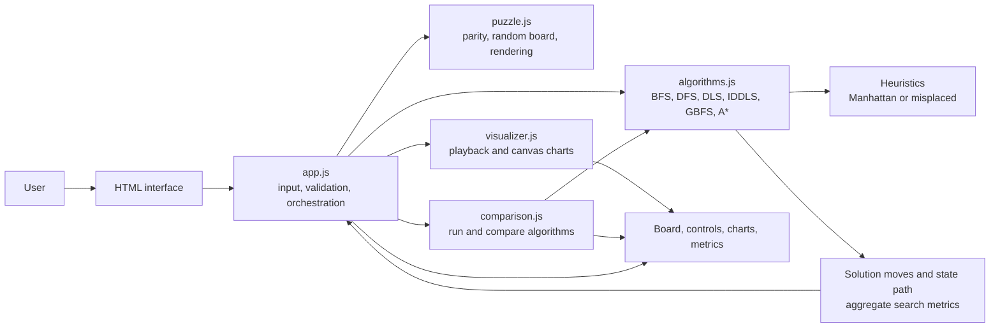
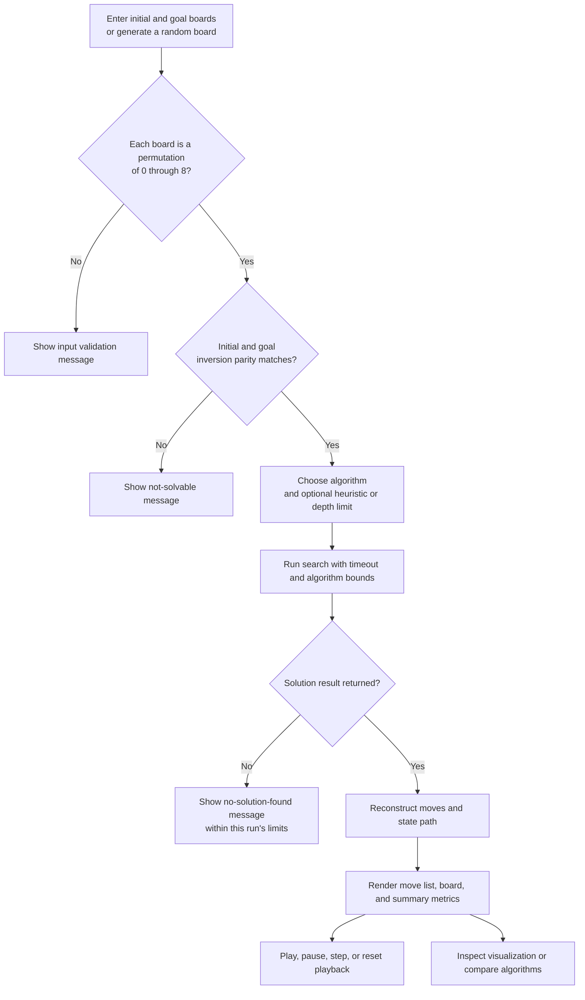

# AI 8-Puzzle Visualizer

An interactive, browser-based visualizer for classical search algorithms solving the 8-puzzle. Configure an initial and goal board, choose a search strategy, and inspect the returned move sequence, playback, and search metrics.

> **Demo video:** Not available yet. See [Optional demo video](#optional-demo-video) for the placeholder.

## Table of contents

- [Overview](#overview)
- [The 8-puzzle problem](#the-8-puzzle-problem)
- [Features](#features)
- [Search algorithms and heuristics](#search-algorithms-and-heuristics)
- [System architecture](#system-architecture)
- [Application workflow](#application-workflow)
- [Project structure](#project-structure)
- [Technology stack](#technology-stack)
- [Prerequisites and setup](#prerequisites-and-setup)
- [How to use](#how-to-use)
- [Results and metrics](#results-and-metrics)
- [Validation](#validation)
- [Screenshots and demo](#screenshots-and-demo)
- [Limitations](#limitations)
- [Future enhancements](#future-enhancements)
- [Contributing](#contributing)
- [Acknowledgements](#acknowledgements)

## Overview

The 8-puzzle is a small state-space search problem: eight numbered tiles move within a 3×3 board around one blank cell. This project provides an educational interface for entering a board, running one of six implemented search algorithms, and inspecting the resulting solution path and summary metrics. The app runs entirely in the browser; its search implementations are in plain JavaScript.

### Problem statement

Given a starting arrangement and a goal arrangement, find a sequence of legal blank moves that transforms the start into the goal. The application lets users compare uninformed and heuristic-guided search on the same puzzle.

### Objectives

- Make the board state and legal moves easy to explore.
- Demonstrate how different search strategies return paths.
- Expose node counts, elapsed time, frontier size, and solution length for a run.
- Let users step through, play, pause, and reset a solution.

## The 8-puzzle problem

A state is represented internally as a flat array of nine numbers, read row by row. `0` represents the blank. A legal move swaps the blank with an orthogonally adjacent tile. The default goal is:

```text
1 2 3
4 5 6
7 8 _
```

For example, the app's initial example is `[1, 2, 3, 4, 0, 6, 7, 5, 8]`, which is two moves from the default goal. The UI accepts any permutation containing each value from `0` through `8` exactly once. For a 3×3 board, the app compares inversion parity between the initial and goal arrangements to determine reachability.

## Features

- Manually enter initial and goal boards, generate a random solvable initial board, or restore the default goal.
- Choose BFS, DFS, DLS, IDDLS, GBFS, or A*.
- Select Manhattan distance or misplaced tiles for GBFS and A*.
- Set a depth limit for DLS; the UI initializes it to 30 and bounds the input from 1 to 100.
- View the solution as a move list and board sequence; use play/pause, previous, next, reset, and animation-speed controls.
- Compare all six algorithms on the same board and view tables and canvas bar charts.
- Inspect summary search metrics and a canvas visualization in the Visualization tab.
- Use responsive layouts for smaller screens.

## Search algorithms and heuristics

All algorithms use unit-cost moves. The implementation returns `null` when it does not find a solution within its search bounds or timeout guard; a null result does not mean that a valid puzzle is mathematically unsolvable.

| Algorithm | Search behavior in this project | Practical note |
| --- | --- | --- |
| Breadth-First Search (BFS) | Explores states in increasing depth with a queue and visited set. | Finds a minimum-move solution for this unit-cost graph if it completes. Uses substantial memory as the frontier grows. |
| Depth-First Search (DFS) | Uses a stack, a global visited set, and a maximum depth of 80. | May return a non-shortest path; the depth bound and 8-second guard can prevent a result. |
| Depth-Limited Search (DLS) | Recursively explores paths up to the selected depth limit with path-local cycle avoidance. | Can miss a solution deeper than the limit. The implementation maps cutoffs and timeouts to `null`. |
| Iterative Deepening DLS (IDDLS) | Repeats depth-limited search from limit 0 through 50. | For unit-cost search, the first found goal is at the shallowest reached depth; the implementation also has a 10-second guard and a maximum limit of 50. |
| Greedy Best-First Search (GBFS) | Orders its open list by `h(n)` alone. | Often directs search toward the goal, but does not account for path cost and does not guarantee a shortest solution. |
| A* | Orders its open list by `f(n) = g(n) + h(n)` and tracks best known path costs. | With either implemented heuristic and unit step costs, these heuristics are admissible; in the usual graph-search formulation this supports shortest paths when the search completes. A time guard still applies. |

The priority queues for GBFS and A* are arrays sorted before each removal, rather than heap data structures. Each search routine has an approximately 8-second guard, except IDDLS, which uses 10 seconds. Timing is browser- and device-dependent.

### Heuristic functions

Both heuristics ignore the blank tile and measure distance from each numbered tile to its position in the selected goal state.

- **Manhattan distance:** sum of row and column distances for all numbered tiles.
- **Misplaced tiles:** count of numbered tiles not already in their goal positions.

For this puzzle, each is a lower bound on the number of remaining moves. The selection is relevant to GBFS and A*; uninformed algorithms do not use it.

## System architecture

The app uses global browser scripts loaded in dependency order. `app.js` connects the UI to puzzle utilities, search functions, playback, charts, and comparison routines. Search algorithms return a solution plus aggregate metrics, which the UI renders and passes to the visualizer.



## Application workflow

The solver checks that both boards contain every value from 0 to 8 once and compares inversion parity before search. On success, the solver returns moves, board states, and counters; the page then initializes playback and updates the result panels. An invalid or parity-mismatched board is reported before the search begins.



## Project structure

This diagram lists the tracked files present in the repository. The scripts are loaded directly by `index.html`; there is no build or package configuration.

```text
AI-8Puzzle-Visualizer/
├── index.html            # App markup, tabs, controls, and script loading order
├── css/
│   ├── styles.css        # Layout, component styling, responsive rules
│   └── animations.css    # Tile, loading, and interface animations
└── js/
    ├── algorithms.js     # Search algorithms, heuristics, successors, path building
    ├── puzzle.js         # Solvability, random generation, board rendering, demo board
    ├── visualizer.js     # Solution playback and canvas charts/state display
    ├── comparison.js     # Runs all algorithms and fills comparison table/charts
    └── app.js            # UI events, input validation, orchestration, output updates
```

## Technology stack

- HTML5 for the page and controls.
- CSS3 for styling, responsive layout, and animation.
- Vanilla JavaScript for puzzle state, search algorithms, application behavior, playback, and chart drawing.
- HTML Canvas 2D for charts; there is no charting dependency or other runtime library.
- Google Fonts (`Outfit` and `JetBrains Mono`) are loaded by the page when network access is available; system fallbacks are defined in CSS.

## Prerequisites and setup

No package manager, compiler, or third-party JavaScript dependency is required. Use a current desktop or mobile browser with JavaScript enabled.

1. Clone the repository or download its source archive.
2. Open `index.html` in a browser.

For a local HTTP server, Python 3 is optional:

```bash
python -m http.server 8000
```

Then open [http://localhost:8000](http://localhost:8000). Run the command from the repository root. The server is only a convenient way to serve static files; the project has no backend.

## How to use

1. Open the **Puzzle Solver** tab.
2. Enter the initial and goal boards as digits `0`–`8`, each once. Leave the blank cell empty to represent `0`.
3. Alternatively, choose **Random** for a generated solvable board. The default goal is `1 2 3 / 4 5 6 / 7 8 0`.
4. Select an algorithm. For DLS, choose a depth limit. For GBFS or A*, choose Manhattan distance or misplaced tiles.
5. Select **Solve Puzzle**. The app rejects invalid permutations or mismatched inversion parity before search.
6. Review the move list and metrics. Use playback controls to play, pause, step forward or backward, reset, or change the speed.
7. Open **Visualization** for run summary and state display. Open **Comparison**, select its heuristic, and run all algorithms against the current puzzle.

## Results and metrics

A successful search returns:

- **Solution / moves:** blank movement directions (`U`, `D`, `L`, `R`) and a corresponding sequence of board states, including the starting board.
- **Nodes explored:** states processed by the algorithm's counters.
- **Nodes generated:** successor-generation counter, which may include states subsequently rejected as duplicates.
- **Maximum frontier:** largest recorded open-list or stack size. Recursive DLS/IDDLS do not measure the recursion frontier meaningfully, so their reported value remains 1.
- **Time:** elapsed search time from `performance.now()`, in milliseconds.
- **Solution depth / moves:** number of moves in the returned path.

The Visualization tab's search-growth chart is a schematic derived from the final explored-node and maximum-frontier totals; it is not a time series captured during individual expansions. The state explorer renders up to 50 states from the returned solution path, not the full set of explored states. Comparison results are also run sequentially in the browser, so difficult inputs can make the page busy until a search returns or its time guard is reached.

## Validation

There is no automated test suite or test command in this repository. For a manual smoke check, open the page and try:

- The default example `[1, 2, 3, 4, 0, 6, 7, 5, 8]` with the default goal; it should be solvable in two moves.
- The already solved default goal as both initial and goal; it should return a zero-move path.
- A board with a duplicate or missing digit; the UI should request each digit from 0 to 8 exactly once.
- A parity-mismatched permutation such as `[1, 2, 3, 4, 5, 6, 8, 7, 0]` against the default goal; the UI should report it as unsolvable.

## Screenshots and visual demonstrations

No screenshot assets are included in the repository. The running application itself provides the visual demonstration.

## Optional demo video

A demo video has not been provided yet. Add a real recording later and replace this placeholder with its relative path or a verified hosted link.

```text
Demo video: To be added
```

## Limitations

- Search runs synchronously on the browser's main thread; larger searches can temporarily reduce UI responsiveness.
- Search routines have time guards, and DFS, DLS, and IDDLS also have depth bounds. A failed run can therefore mean the run stopped before finding a solution.
- DFS does not promise a shortest path. GBFS is heuristic-guided but does not promise a shortest path.
- The comparison is a local, single-run observation; browser/device load affects elapsed time, and it is not a benchmark suite.
- The search-growth chart is estimated from summary values, and the state explorer shows the returned path rather than all visited states.
- External Google Fonts may not load without network access; local fallback fonts are used.

## Future enhancements

- Record actual per-expansion frontier and explored-set samples for a faithful search-growth chart.
- Move long-running search into a Web Worker to keep controls responsive.
- Add automated unit tests for solvability, successor generation, heuristics, and solution validity.
- Add exportable run summaries and configurable search limits.
- Include real screenshots and a recorded demo when available.

## Contributing

Contributions are welcome. For a focused change, describe the behavior being addressed, keep the app dependency-free unless a dependency is justified, and verify the relevant UI flow in a browser. Please avoid committing generated files, credentials, or unrelated personal files.

## Acknowledgements

This project presents classical state-space search ideas in the context of the 8-puzzle, an introductory problem commonly used to teach artificial intelligence search. The footer identifies it as an AI course assignment.
